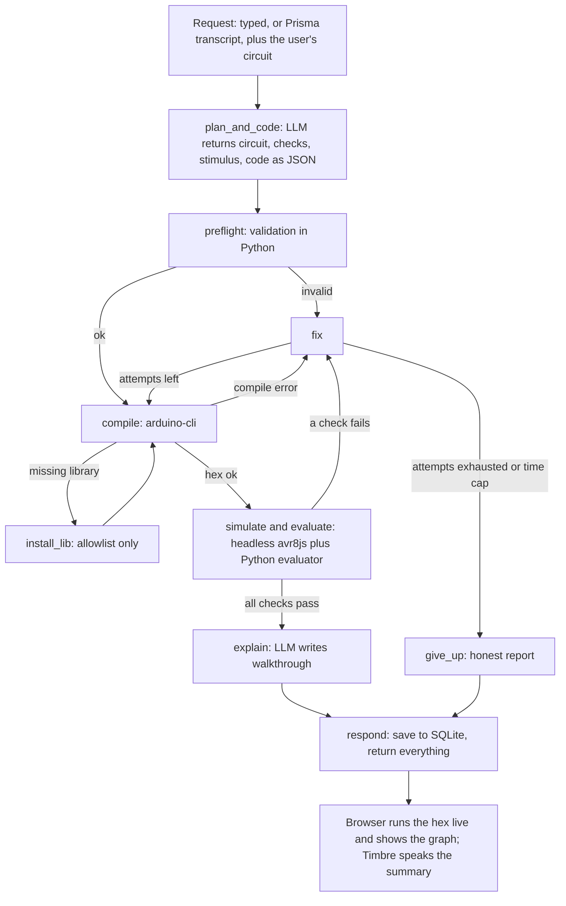

# WORKFLOW.md: the agent design for the Voice-to-Hardware Simulator

Last updated: 2026-11-07. Companion to `CLAUDE.md`. CLAUDE.md says **what, why and in what order**; this file says **exactly how the agent works**. Build it phase by phase as laid out in CLAUDE.md section 8. Phase 1 needs none of this file.

## 1. Decisions (settled)

| Question | Decision | Reason |
|---|---|---|
| Agent framework | **Plain LangGraph.** No LangChain code. | The loop (generate, compile, verify, fix) is a graph with conditional retries. Gnani and LLM calls are plain `httpx` calls inside nodes. |
| Database | **Tiny SQLite.** Not critical to the demo. | Used so refinements ("make it slower") remember the current circuit and code, and for a run history. If it causes trouble, use LangGraph's in-memory `MemorySaver`. |
| Redis | **No.** | Single-user demo; it has no native Windows build and solves problems we do not have. |
| Self-looping agent | **Yes**, capped and measured. | The loop is the standout feature. |
| Explain the code | **Yes**, a dedicated `explain` step. | The user gets code plus a plain-language walkthrough. |
| Pin numbers | **Owned by the circuit spec and backend**, never invented by the LLM. | Keeps code and circuit in sync (section 5). |
| LLM provider | **Behind `llm.py`.** Evon if the Gnani platform serves it, otherwise a swappable hosted LLM. | Evon's API availability is unconfirmed (CLAUDE.md section 2). |

## 2. The principle that makes this more than a prompt

**The LLM never decides whether it succeeded. Measurements do.**
1. From the user's words, the agent writes **acceptance checks** in a small fixed vocabulary (section 8), for example "pin 9 duty rises above 80% and falls below 20% with a period between 1.5 s and 3 s".
2. The real code is compiled and simulated headlessly.
3. A **plain Python evaluator** compares the measured pin data with the checks. No LLM is involved.
4. Failures go back to the LLM **with the numbers**. The "verified" list shown to the user is built from the evaluator's results, never written freely by the LLM.

## 3. Flow


Everything from `plan_and_code` to `respond` is one LangGraph run. Retries are conditional edges. A fix that failed `preflight` returns to `preflight`; any other fix goes to `compile`.

## 4. Graph state (one dict passed between nodes)

```
session_id, user_text
circuit            # {components: [{type, id, pin}]}  (user's circuit, possibly updated by the LLM)
checks, stimulus   # acceptance checks and input stimuli (section 6)
code               # LLM-written sketch body (without the #define block)
full_code          # #define block + code, exactly what is compiled
hex                # compiled program text
attempts           # fix cycles used (cap 3)
history            # list of {attempt, stage, problem, change_made}; fed back to the LLM
compile_error, measurements, verdict, report
explanation, spoken_summary, status   # status: "passed" | "gave_up"
```

## 5. Board definition and pin injection (the backend owns the numbers)

1. **`backend/boards/<id>.json`** (one board profile per board, since Nov 9; originally `board_uno.json`; read by the backend and the browser) lists every Uno pin with its Arduino number, AVR port and bit, PWM capability and timer, and notes:
   - D0 to D7 are PORTD bits 0 to 7 (D0 and D1 are serial: avoid).
   - D8 to D13 are PORTB bits 0 to 5 (pin 13 is PB5, pin 9 is PB1).
   - A0 to A5 are PORTC bits 0 to 5.
   - PWM pins: 3 (Timer2), 5 (Timer0), 6 (Timer0), 9 (Timer1), 10 (Timer1), 11 (Timer2).
2. **Circuit spec** (what the UI draws and what voice commands edit):
   ```json
   {"components": [
     {"type": "led",    "id": "LED1",    "pin": 9},
     {"type": "servo",  "id": "SERVO1",  "pin": 6},
     {"type": "button", "id": "BUTTON1", "pin": 2}
   ]}
   ```
   Allowed types at first: `led`, `button`, `servo`; later `buzzer`, maybe `potentiometer` (pin `A0`).
3. **The backend prepends generated `#define` lines** (component id plus `_PIN`) to the LLM's code, and the prompt requires using only those names:
   ```cpp
   #define LED1_PIN 9
   #define SERVO1_PIN 6
   #define BUTTON1_PIN 2
   ```
   The LLM writes `pinMode(LED1_PIN, OUTPUT)`, never `pinMode(9, OUTPUT)`. Rewiring by voice changes only the spec and the defines, so code cannot drift out of sync with the circuit.
4. **Pin rules checked in `preflight`** (real Uno behavior):
   - `analogWrite` (breathing, dimming) needs a PWM pin: 3, 5, 6, 9, 10, 11.
   - The `Servo` library works on any digital pin but disables `analogWrite` on pins 9 and 10.
   - `tone()` (buzzer) uses Timer2 and interferes with PWM on pins 3 and 11.
   - Avoid pins 0 and 1 (serial). No two components share a pin.
   - A button between the pin and GND is read with `INPUT_PULLUP`: pressed is LOW.
5. **The verifier uses the same board file** to know which port, bit and timer to watch for each pin.
6. **If the user does not name a pin** ("add a servo"), the agent picks a compatible free pin (a PWM pin when needed, never 0 or 1), writes it into the spec so the UI shows it, and says it aloud ("I put the servo on pin 6").

## 6. Data contracts (strict JSON in and out of the LLM)

**`plan_and_code` output:**
```json
{
  "circuit": {"components": [{"type": "led", "id": "LED1", "pin": 9}]},
  "checks": [
    {"type": "breathe", "target": "LED1", "min_duty_below": 0.2, "max_duty_above": 0.8,
     "period_ms_min": 1500, "period_ms_max": 3000}
  ],
  "stimulus": [],
  "code": "void setup() { ... }\nvoid loop() { ... }",
  "behavior_summary": "LED1 fades up and down about every 2 seconds."
}
```
- `circuit` is the full circuit. It is the user's circuit unchanged unless the user asked to add, move or remove a part.
- Checks and stimulus refer to components by `target` id; the backend resolves ids to pins. Duty values are 0 to 1.
- `code` must not contain the `#define` block.

**`fix` output:** `{"code": "...", "checks": [...optional...], "stimulus": [...optional...], "note": "what changed and why"}`. Return `checks` only if the original request was misread.

**`explain` output:** `{"summary": "...", "walkthrough": [{"lines": "3-5", "what": "...", "why": "..."}], "try_next": ["...", "..."], "spoken_summary": "..."}`.

**Parsing:** strip code fences, parse JSON, validate required keys. If parsing fails, re-ask once with "return valid JSON only"; a second failure counts as a fix attempt.

## 7. Nodes

### 7.1 `plan_and_code` (LLM)
- Input: the request, the **circuit the user designed in the UI**, the board facts (PWM pins, pin rules), and the current code if this is a refinement (from the checkpoint). The user's circuit is the source of truth: the agent writes code for that wiring and does not silently rewire it. If the user asks by voice to add or move a part, return an updated `circuit` and the UI redraws.
- System prompt must state: Arduino Uno only; use only the `*_PIN` names, never literal pin numbers; no libraries except `Servo`; no `Serial`; keep the sketch under about 80 lines; for smooth effects use simple `millis()` timing or short `delay()` steps; return **JSON only** in the section 6 format.
- Checks are written from the user's words, not reverse-engineered from the code.
- One call for plan and code keeps latency down. Split into two calls only if the model proves unreliable.

### 7.2 `preflight` (pure Python, instant, no LLM)
Build `full_code` (defines plus code), then reject before compiling if:
- JSON keys or types are wrong, a component type or check type is not allowed, a pin does not exist or is shared.
- The section 5 pin rules are violated (for example `analogWrite` on a non-PWM pin).
- The code passes a **literal number** to `pinMode`, `digitalWrite`, `digitalRead`, `analogWrite`, `tone` or `servo.attach` (regex check).
- The code is empty or over about 120 lines or 8 KB.
Failure goes to `fix` with a precise message ("analogWrite on pin 7, which is not PWM-capable").

### 7.3 `compile` (arduino-cli, about 1.8 s)
- Write `full_code` to `<tmp>/sketch/sketch.ino` and run `arduino-cli compile --fqbn arduino:avr:uno --output-dir <tmp>/out <tmp>/sketch` with `subprocess.run([...], capture_output=True, text=True, timeout=60)`. Argument lists only, never shell strings.
- Success: read `sketch.ino.hex` (not `with_bootloader`). Failure: keep the first useful lines of stderr as `compile_error`.

### 7.4 Error routing after a failed compile (plain Python rules first)
- `fatal error: Foo.h: No such file or directory`: go to `install_lib` (once per run).
- Anything else: go to `fix` with the error text.
- **Repeat-error guard:** if the same normalized error appears twice in a row, tell `fix` to rewrite the sketch more simply from scratch instead of patching.

### 7.5 `install_lib` (small, guarded, optional; first thing to cut)
- Most demos need no library: `Servo`, `Wire`, `SPI` and `EEPROM` ship with the AVR core.
- Only a **hard-coded allowlist** (header name to library name). Never pass LLM-written text to a shell. Command: `subprocess.run(["arduino-cli", "lib", "install", "<allowlisted name>"], ...)`. At most one install per run, then recompile. This does not count as a fix attempt.
- A header not on the allowlist is treated as a normal compile error and sent to `fix` (use built-in functions instead).
- The runtime never installs pip or npm packages. Project dependencies are installed during development only.

### 7.6 `simulate and evaluate` (verification)
- Python resolves checks and stimulus from component ids to pins using the circuit and board file, computes `duration_ms` (section 8), and runs `node verify/verify.mjs <hexfile> <config-json>` with `subprocess.run(..., timeout=30)`.
- `verify.mjs` (own `package.json`; `npm install avr8js` inside `backend/verify`): load the hex into avr8js, create the CPU, **timers 0, 1 and 2**, and ports B, C and D; attach listeners for the watched pins; run until `cpu.cycles` reaches `duration_ms * 16000`; apply stimulus when its time is reached (drive input pins with the port's pin-setting method; check the avr8js docs for the exact call); print JSON to stdout:
  ```json
  {"duration_ms": 4000, "pins": {"9": [[0.0, 0], [0.51, 1], [1.02, 0]]}}
  ```
  Each entry is `[time_ms, level]` with sub-millisecond precision (`cpu.cycles / 16000`).
- `evaluator.py` (pure Python): `evaluate(checks, measurements)` returns `{"passed": bool, "results": [{"check", "ok", "detail"}]}`. Example detail: "pin 9 duty ranged 12% to 71%; expected a maximum above 80%".
- **Test early** that several simulated seconds run in reasonable wall-clock time. If too slow, shorten the window.

### 7.7 `fix` (LLM)
- Input: the request, the circuit, the current code, the problem (compile error, preflight message, or failed check **with numbers**), and `history` so it does not repeat earlier mistakes.
- Output: section 6 fix format. Increment `attempts`, append `{attempt, stage, problem, change_made}` to `history`.

### 7.8 `give_up` (honest failure)
Reached when `attempts` exceeds 3 or total run time exceeds about 90 s. Return the last code, the last problem and a short plain explanation. **Never fake success.** `spoken_summary` says plainly that it could not get it working and why.

### 7.9 `explain` (LLM, only after all checks pass)
The LLM supplies only `summary` (2 sentences), `walkthrough` (block by block: what each part does and why), `try_next` (2 or 3 voice commands to try), and `spoken_summary` (1 or 2 short sentences). **The backend adds `verified` from the evaluator's results and `fixes_made` from `history`.** Beginner level: say what `pinMode`, `analogWrite` and `delay` are doing in this sketch. The UI shows the full explanation with the code. Timbre speaks only `spoken_summary`, never code.

### 7.10 `respond`
Save the run to SQLite; return `{circuit, code, full_code, hex, checks, report, explanation, spoken_summary, history, status}`. The browser loads the hex into avr8js and shows the live circuit and graph; the live result should agree with the headless one.

## 8. Check vocabulary and evaluator rules

> **Built in Phase 3 (Nov 8), this replaces the table below where they differ.** Implemented types: `steady`, `blink`, `breathe`, `duty` (brightness level), `servo_angle`, `servo_sweep`, `tone` (buzzer Hz). `reacts_to_input` was replaced by **time windows**: any check may carry `from_ms`/`to_ms`, and stimulus (`press`/`release` for buttons, `set` 0-1023 for potentiometers) happens between windows. Preflight rejects a window that contains a stimulus, and pulls impossible thresholds back to measurable ones (breathe 10%/90%, sweep 15°/165°, ranges at least ±15%). Blink needs 2 rising edges (one full cycle). `duration_ms` = max(4000, from + 2.5 × period_max, last stimulus + 1500), capped at 12000. Servo constants 544/2400 µs confirmed in Servo.h 1.3.0. See `backend/evaluator.py` and `CHECKS_DOC` in `backend/graph.py`.

Start with the first three; add the rest in order if time allows. All times in ms, duty 0 to 1.

| Check | Params | Evaluator rule |
|---|---|---|
| `steady` | target, level (`high` or `low`) | No transitions after 100 ms and final level matches. |
| `blink` | target, period_ms_min, period_ms_max | Take rising edges, compute intervals; need at least 3 intervals; the median must be within range. |
| `breathe` | target, min_duty_below, max_duty_above, period_ms_min, period_ms_max | Compute duty in 50 ms windows (about 25 PWM cycles at 490 Hz). The minimum window duty must be below `min_duty_below`, the maximum above `max_duty_above`, and the time between successive peaks within the period range. |
| `reacts_to_input` | input, output, after_ms, expect (a `blink` or `steady` rule) | Apply `expect` to the output pin's transitions after `after_ms`; the stimulus list must press the input at that time (pressed = LOW with `INPUT_PULLUP`). |
| `servo_angle` | target, angle_deg, tolerance_deg, after_ms | Measure HIGH pulse widths on the servo pin (one pulse about every 20 ms), take the median after `after_ms`, convert with the Servo library defaults: angle = (pulse_us - 544) / (2400 - 544) x 180. Verify these constants against the library before trusting them. |

**`duration_ms`** is computed by Python: at least 4000, and at least 2.2 times the longest `period_ms_max` among the checks (so at least two full cycles are seen), capped at 8000.
**Timers:** Timer0 is needed for `delay()` and `millis()`; Timer1 for PWM on pins 9 and 10 and for the Servo library; Timer2 for `tone()` and PWM on pins 3 and 11. `verify.mjs` creates all three; confirm each one works when first used.
**Browser display for servo:** set the `angle` of `<wokwi-servo>` from the same pulse-width measurement.

## 9. Loop limits (protect credits and time)
- Maximum **3 fix attempts** per request, **1 library install**, about **90 s** total per request, **30 s** timeout per LLM call.
- Repeat-error guard (7.4).
- Prisma and Timbre are called **once per request**. Never loop on them. During development test with typed input and few runs.

## 10. API endpoints and progress streaming

| Endpoint | Purpose | Phase |
|---|---|---|
| `GET /health` | Check that backend, arduino-cli and node are found. | 1 |
| `POST /compile` | `{code}` returns `{ok, hex}` or `{ok: false, error}`. Kept as a dev endpoint. | 1 |
| `POST /run` | `{session_id, text, circuit}` runs the graph. Optional dev flag `debug_break=1` injects a compile error on attempt 1. | 2 (streaming in 3) |
| `POST /transcribe` | Audio in, text out (Prisma). | 4 |
| `POST /speak` | Text in, audio out (Timbre). | 4 |
| `GET /runs?session_id=` | Optional run history. | 3+ |

`POST /run` streams progress as Server-Sent Events from LangGraph's `stream`: `planning`, `preflight`, `compiling (attempt n)`, `verifying`, `fixing: <short reason>`, `explaining`, then a final `result` event with the section 7.10 payload. `EventSource` cannot send POST, so the browser reads the stream with `fetch` and a `ReadableStream`. The UI shows the events as a live status line; visible self-correction is a highlight of the demo.

## 11. Database (SQLite, `backend/gnani.db`)
- `sessions(id, created_at)`
- `runs(id, session_id, request_text, circuit_json, code, hex, verdict, attempts, created_at)`
- LangGraph's SQLite checkpointer stores per-session graph state so follow-ups know the current circuit and code. Install the SQLite checkpoint package for LangGraph and follow the current LangGraph docs for its exact name and usage.
- The browser creates a `session_id` (a UUID kept in `localStorage`) and sends it with each request.

## 12. Safety notes
- `subprocess` calls use argument lists and timeouts; temp directories per request; size limits on code.
- LLM output never reaches a shell. Library installs come from the allowlist only.
- API keys live in `.env` (loaded in the backend) and are never logged or committed. CORS is limited to localhost for now.

## 13. Build order
This matches CLAUDE.md section 8: Phase 1 (compile and LED, no agent), Phase 2 (sections 4 to 7.4 plus 7.7, 7.8 and 7.10, text only), Phase 3 (7.6, 7.9, section 8, streaming, circuit panel, graph), Phase 4 (voice, voice rewiring, `install_lib` only if time is left), Phase 5 (polish, demo, post).
If behind on Nov 9 morning, cut: `install_lib`, `reacts_to_input`, buzzer, history UI, voice rewiring. **Never cut:** the verify loop, real Prisma and Timbre use, the explanation, and the demo video.
